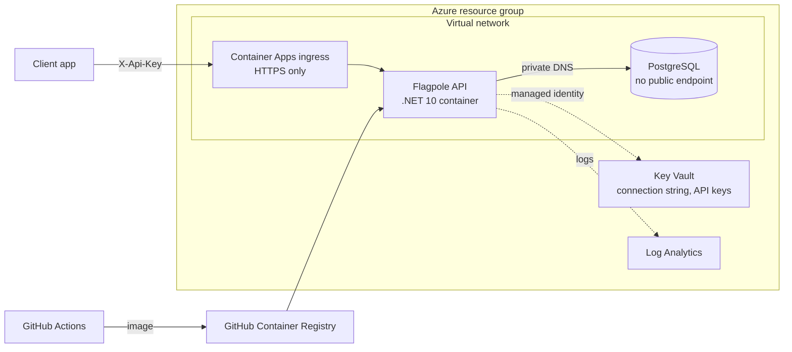

# Flagpole

[](https://github.com/AlbinCode/flagpole/actions/workflows/ci.yml)


**A feature flag service in C#/.NET, built to run on Azure.**

Feature flags let a team ship code switched off, turn it on for testers first, then roll it out to 10%, 50% and 100% of users, and switch it off again in seconds if something breaks, all without a new deploy. Flagpole is a small, self-hosted service for that, with the infrastructure, pipeline and security controls a production service needs.

## Highlights

- **Gradual rollouts** with stable, deterministic user bucketing, so a user never flips between on and off
- **Environments** (development, staging, production) configured independently
- **Target users** who always get a feature, for example testers
- **Audit log** of every change, with who made it
- **API key authentication** with admin and reader roles and constant-time key comparison
- **Rate limiting** per API key on the evaluation endpoints
- **In-memory caching** so evaluations rarely hit the database
- **Health checks** for liveness and readiness
- **60 automated tests**: unit tests for the rules, integration tests for the whole API
- **Infrastructure as code** in Bicep: Container Apps, PostgreSQL on a private network, Key Vault and managed identity
- **CI/CD** in GitHub Actions: tests, container image to GHCR, Bicep validation, and a security scan of the infrastructure with [Skylock](https://github.com/AlbinCode/Skylock), my own IaC scanner

## Architecture



| Part | Technology |
| --- | --- |
| API | ASP.NET Core 10 minimal APIs, OpenAPI, ProblemDetails |
| Data | Entity Framework Core 10 with PostgreSQL, migrations |
| Domain logic | Separate `Flagpole.Core` library with no dependencies |
| Tests | xUnit, `WebApplicationFactory`, SQLite in-memory |
| Container | Multi-stage Dockerfile, chiseled runtime image, non-root user |
| Hosting | Azure Container Apps with autoscaling (1 to 3 replicas) |
| Secrets | Azure Key Vault with RBAC, read through a user-assigned managed identity |
| Network | Virtual network, delegated subnets, private DNS zone for PostgreSQL |
| IaC | Bicep, validated and security-scanned in CI |
| CI/CD | GitHub Actions, GHCR, OpenID Connect sign-in to Azure, Dependabot |

## How a flag is evaluated

The rules live in [`FlagEvaluator`](src/Flagpole.Core/FlagEvaluator.cs) and are checked in this order:

1. The flag does not exist: **off** (`FlagNotFound`). Clients fall back to the old behaviour instead of failing.
2. The environment has no configuration: **off** (`EnvironmentNotConfigured`).
3. The flag is disabled: **off** (`Disabled`). This is the kill switch, and it wins over everything else.
4. The user is a target user: **on** (`TargetedUser`).
5. The rollout is 100%: **on** (`FullRollout`). 0%: **off** (`RolloutExcluded`).
6. A partial rollout without a user id: **off** (`MissingUserForRollout`).
7. Otherwise the user's bucket decides: **on** if it is below the rollout percentage.

Every response includes the reason, which makes "why don't I see the new feature?" easy to answer.

## Design decisions

**Stable rollouts with SHA-256, not `GetHashCode`.** `string.GetHashCode` is randomized per process in .NET, so users would land in different buckets after every restart and on every replica. [`RolloutBucket`](src/Flagpole.Core/RolloutBucket.cs) hashes `flagKey:userId` with SHA-256 instead. Including the flag key means a user who is early in one rollout is not early in every rollout. A test checks that raising the percentage never turns a feature off for a user who already had it.

**Cache with a short TTL.** Evaluations are far more common than changes, so flags are cached in memory for 30 seconds. A change made through one replica clears that replica's cache immediately; other replicas pick it up within 30 seconds. That is an acceptable delay for feature flags. A shared cache or pub/sub would remove it if it ever mattered.

**Unknown flags are off, not 404.** If a flag is deleted while a client still asks for it, the client gets "off" and keeps working.

**Constant-time API key comparison.** Keys are compared with `CryptographicOperations.FixedTimeEquals` on their SHA-256 hashes, so response times do not reveal how much of a guessed key was correct.

**No public database.** PostgreSQL is only reachable from inside the virtual network. The connection string and API keys live in Key Vault, and the container app reads them with a managed identity that only has the *Key Vault Secrets User* role on that vault.

**Safe container image.** The runtime image is Microsoft's chiseled .NET image: no shell and no package manager, and it runs as a non-root user.

## API

All endpoints need an `X-Api-Key` header. Admin keys can do everything; reader keys can only evaluate.

| Method | Route | Role | Description |
| --- | --- | --- | --- |
| GET | `/api/flags` | admin | List flags |
| GET | `/api/flags/{key}` | admin | Get one flag |
| POST | `/api/flags` | admin | Create a flag |
| PUT | `/api/flags/{key}/environments/{environment}` | admin | Configure a flag in one environment |
| DELETE | `/api/flags/{key}` | admin | Delete a flag |
| GET | `/api/flags/{key}/audit` | admin | Change history |
| GET | `/api/evaluate/{key}?environment=&userId=` | reader | Evaluate one flag |
| POST | `/api/evaluate` | reader | Evaluate up to 50 flags at once |
| GET | `/health/live`, `/health/ready` | none | Health checks |

Example: roll out a new checkout to testers plus 10% of production users.

```bash
ADMIN="X-Api-Key: local-admin-key-for-development-only-0001"
READER="X-Api-Key: local-reader-key-for-development-only-0001"

curl -X POST localhost:8080/api/flags -H "$ADMIN" -H "Content-Type: application/json" \
  -d '{"key":"new-checkout","description":"Redesigned checkout flow"}'

curl -X PUT localhost:8080/api/flags/new-checkout/environments/production -H "$ADMIN" \
  -H "Content-Type: application/json" \
  -d '{"enabled":true,"rolloutPercentage":10,"targetUsers":["tester-1"]}'

curl "localhost:8080/api/evaluate/new-checkout?environment=production&userId=tester-1" -H "$READER"
# {"flagKey":"new-checkout","environment":"production","enabled":true,"reason":"TargetedUser"}
```

## Run locally

With Docker:

```bash
docker compose up --build
```

The API starts on http://localhost:8080 with PostgreSQL, applies migrations and uses the development keys in [`appsettings.Development.json`](src/Flagpole.Api/appsettings.Development.json). The OpenAPI document is at `/openapi/v1.json`.

Run the tests (no database needed):

```bash
dotnet test
```

## Deploy to Azure

1. Create a resource group and an app registration with a federated credential for this repository ([OpenID Connect](https://learn.microsoft.com/azure/developer/github/connect-from-azure-openid-connect)). Give it *Contributor* and *Role Based Access Control Administrator* on the resource group.
2. Add the secrets `AZURE_CLIENT_ID`, `AZURE_TENANT_ID`, `AZURE_SUBSCRIPTION_ID`, `FLAGPOLE_DB_PASSWORD`, `FLAGPOLE_ADMIN_KEY` and `FLAGPOLE_READER_KEY`, and the variable `AZURE_RESOURCE_GROUP`.
3. Run the **Deploy to Azure** workflow with an image tag from a CI run. It shows a what-if preview, then deploys [`infra/main.bicep`](infra/main.bicep) and prints the app URL.

## Project structure

```
src/Flagpole.Core/         Domain model and evaluation rules, no dependencies
src/Flagpole.Api/          ASP.NET Core API, EF Core, auth, caching, endpoints
tests/Flagpole.Core.Tests/ Unit tests for the rules and bucketing
tests/Flagpole.Api.Tests/  Integration tests for the HTTP API
infra/                     Bicep for Azure
.github/workflows/         CI and deploy pipelines
```

## License

MIT
